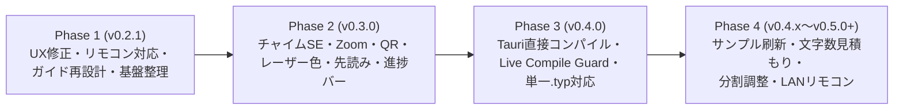

# Typst Presenter 実装ロードマップ（v0.2.1 〜 v0.5.0+）

本書は、[`docs/HANDOFF.md`](./HANDOFF.md) の引き継ぎ事項および実コードベース調査・`/grill-me` での設計合意に基づき、**Typst Presenter** の今後の開発フェーズ・技術的前提・Phase 3 検討項目の比較メモを整理した公式ロードマップです。

---

## 1. 現状ベースラインと実コード確認で把握した前提（v0.2.0 / コミット `d39dcbb` 時点）

### 検証済みベースライン・ローカル環境
- **リポジトリ**: `main` ブランチ最新 `d39dcbb`（作業ツリークリーン）
- **ローカル Typst CLI**: `typst 0.15.1 (9dfd3a08)` 導入済み（直接コンパイル・`typst query` の実機検証が可能）
- **品質ゲート基準**:
  - `npm run typecheck`（`tsc --noEmit`）: エラー 0 件
  - `npm test`（Vitest）: 11 ファイル / 97 件パス
  - `npm run build`: `dist/` 生成成功
  - `npx playwright test --workers=1`: 7 ファイル / 100 件パス

### コードベース上の 5 つの技術的前提
1. **`PresenterConsole.tsx` の肥大化と未使用依存**:
   - [`src/features/presenter/PresenterConsole.tsx`](../src/features/presenter/PresenterConsole.tsx) は 3,535 行に達しており、全状態・キーボードショートカット・同期・描画・タイマー・モーダルが集中している。
   - [`package.json`](../package.json) には `zustand`（`^5.1.0`）が記載されているが、`src/`・`tests/` からの参照は 0 件。
2. **埋め込みノート抽出とホットリロードの同期ギャップ**:
   - [`src/core/pdf/extractors.ts`](../src/core/pdf/extractors.ts) の `parseNotesAttachments` は `Record<number, string>` のみを返すため、JSON 添付内の `targetSeconds` フィールドを直接保持できない（文字列内の `<!-- target: N -->` 経由のみ）。また、`splitMarkdownByHr` が添付 `.md` の先頭 YAML frontmatter を破棄するため、`duration` / `lastMinutes` 等のタイマー設定が引き継がれない。
   - `PresenterConsole.tsx`（L922–L944）の `hotReloadPdfBytes` は、既存の `prevBundle` がある場合に再コンパイル後の `loadedMeta.extractedNotes` を再同期しない。
3. **リモコン互換操作・聴衆投影面の未整備箇所**:
   - `PresenterConsole.tsx`（L1617–L1805）は `.`（黒画面トグル）、`ArrowUp` / `ArrowDown`、`Home` / `End`、および `Escape` でのカーテン・ポインター解除に未対応。
   - [`src/features/audience/AudienceView.tsx`](../src/features/audience/AudienceView.tsx)（L269–L277）のキー転送も `ArrowRight` / `Space` / `ArrowLeft` に限られており、`PageDown` / `PageUp` 等が聴衆ウィンドウフォーカス時に効かない。
   - `AudienceView.tsx`（L323–L333）の右下フルスクリーン案内ピル（`data-testid="fullscreen-prompt"`）は全画面状態判定がなく、全画面中も表示され続ける。
4. **UI レイアウト制約とテスト契約**:
   - 上部ツールバーは 2 段固定（`headerHeight: 77px`）で 2 段目が高密度なため、新機能ボタンはタイマーパネル内・ドロップダウン・コンテキスト操作へ逃がす必要がある。
   - 既存 E2E テストが依存する `aria-label` / `data-testid` 契約（詳細は [`docs/HANDOFF.md`](./HANDOFF.md) セクション 3 を参照）を壊さないこと。
   - [`src/features/presenter/UiGuideOverlay.tsx`](../src/features/presenter/UiGuideOverlay.tsx) に関する既存テストは現在 0 件のため、レイアウト刷新と同時に新規テストを追加しやすい状態。
5. **Tauri v2 の現行構成**:
   - [`src-tauri/Cargo.toml`](../src-tauri/Cargo.toml) と [`src-tauri/capabilities/default.json`](../src-tauri/capabilities/default.json) はウィンドウ制御のみの最小構成であり、ファイルダイアログ・ファイル監視・`typst` サブプロセス実行は今後追加する。
   - `rustc 1.100+` の `#[tauri::command]` マクロ重複回避ルール（`lib.rs` 直下で `pub fn` にせず非公開 `fn` または `commands` サブモジュールへ配置）を遵守する。

---

## 2. 合意済みの全体方針・設計決定（`/grill-me` 合意サマリー）

| 決定項目 | 合意内容 |
| --- | --- |
| **進行順序** | **Phase 1（v0.2.1）→ Phase 2（v0.3.0）→ Phase 3（v0.4.0）→ Phase 4（v0.4.x〜v0.5.0+）** の順に段階的に実装する。 |
| **Phase 1 視覚判断の進め方** | `BlackoutScreenIcon` 修正および `UiGuideOverlay.tsx` 再設計は、複数パターンを試作して実寸スクリーンショット（`14×14px` アイコン、`1280×800` / `1024×680` 画面）を目視比較してから最終案を決定する。 |
| **構造整理・依存管理** | 新機能は独立モジュール／カスタムフック（例: `src/core/audio/`, `src/core/typst/`, `src/features/presenter/hooks/`）へ分離しつつ、既存コードも Phase ごとに段階分割する。未使用の `zustand` は削除し、React 標準 hooks で統一する。 |
| **Phase 2 のスコープ** | チャイム SE（全体タイマー連動の学会形式 1/2/3 鈴、Web Audio API、デフォルト OFF）、Zoom `Z`（カーソル中心ホイール拡大 1.0x〜4.0x＋ドラッグパン＋確定時高解像度再描画＋レーザー/ペン併用）、レーザー色切替、隣接ページ先読み、Q&A 用 QR コード、聴衆極薄プログレスバーをすべて含める。 |
| **Phase 3 コンパイラ調達** | システム `PATH` の `typst` CLI を優先検出し、未検出時は導入ガイドを表示する（将来の Tauri Sidecar 同梱余地は残し、Phase 3 着手時に最終判断）。 |
| **Phase 3 保留事項** | 単一 `.typ` ファイル原稿の方式（付録 A）、および周辺機能候補 3 点（付録 B〜D：`pageLabels` ノート共有・ローカル `.md` 直接上書き・CLI 引数起動）は、付録の比較メモをもとに Phase 3 着手前に確定する。 |

---

## 3. フェーズ別実装ロードマップ

### Phase 1（v0.2.1）: クイックウィン UX 改善 ＆ 足場固め【完了: `f14dd60` / Tauri実機修正 `b5c9617`】

本番運用で目につく小さな不具合を最速で解消し、次フェーズ以降の保守性を高める段階です。

1. **黒画面アイコンの改善（HANDOFF #3）**
   - `PresenterConsole.tsx`（L98–L126）の `BlackoutScreenIcon` が `14×14px` で `D` に見える問題を解消する。
   - **案 1（文字 `B` 修正）** と **案 2（形状差別化：黒塗りモニター＋斜線 / 白塗りモニター＋ハロー線）** の 2 案を実寸ツールバー上でスクリーンショット比較して採用決定。
2. **プレゼンターリモコン互換 ＆ 聴衆画面クリーンアップ**
   - `PresenterConsole.tsx` に `.`（黒画面トグル）、`ArrowUp` / `ArrowDown`、`Home` / `End`、および `Escape` によるカーテン／ポインターツール解除を追加。
   - `AudienceView.tsx` のキー転送に `PageDown` / `PageUp` / `ArrowDown` / `ArrowUp` / `.` を追加。
   - `AudienceView.tsx` の右下 `fullscreen-prompt` ピルをフルスクリーン中（`fullscreenchange` 監視＋Tauri 全画面状態）は非表示化し、一定時間無操作時にマウスカーソルを自動隠蔽。
3. **オーバーレイ型ヘルプ（`UiGuideOverlay.tsx`）のレイアウト再設計（HANDOFF #4）**
   - 39 個の同時吹き出し＋直交リード線による情報混雑を解消するため、以下を試作して `1280×800` / `1024×680`（JP/EN）のスクリーンショットで比較選定：
     - **パターン A**: セクション限定切替型（下部フィルタピルでグループ別表示）
     - **パターン B**: 番号ピン（リード線なし）＋中央ステージ上の 3 カラム対応一覧カード型
     - **パターン C**: 機能グループ単位の集約コールアウト型（12〜14 チップへ集約）
   - 選定後、専用ユニット／E2E テストを新規追加。
4. **開発足場固め**
   - `package.json` から未使用の `zustand` を削除し、依存を整理。
   - Phase 2 以降の新規ロジックを `PresenterConsole.tsx` に直書きせず、独立モジュール／カスタムフックへ分離する構成を適用開始。

- **完了条件**: `npm run typecheck`・`npm test`（大文字ドライブレター起点）・`npm run build`・`npx playwright test --workers=1` 全通過、および 1280×800 / 1024×680（JP/EN × Dark/Light）視覚確認。

---

### Phase 2（v0.3.0）: 発表本番・表現力強化（Web / PWA / Desktop 共通）【完了: `2ee9502` ＋ ズーム1:1 DPR鮮明化修正】

Web 版・PWA・Tauri デスクトップ版の全ユーザーに価値が届く本番支援・表現機能を実装します。

1. **発表チャイム・SE 機能（HANDOFF #5）**
   - `src/core/audio/ChimeEngine.ts` を新設し、Web Audio API（サイン波＋倍音減衰）による完全オフラインのベル合成を実装。
   - 全体タイマー連動の学会形式（残り警告到達＝**1 鈴**、終了時刻 `00:00`＝**2 鈴**、超過＋1 分到達または手動ベルボタン＝**3 鈴**）を二重鳴動防止ラッチ付きで実装。
   - 会場スピーカー誤鳴動を防ぐため **デフォルト OFF** とし、ミュート／音量調整／テスト鳴動 UI をタイマーパネル内に省スペース配置。
2. **スライド部分拡大・パン（Zoom `Z`）**
   - `Z` キーでズームモード切替、ホイールでカーソル中心に拡大（`1.0x〜4.0x`）、ドラッグでパン移動、`Escape` / `0` / ページ送りで解除。
   - ズーム中もレーザーポインター・ペン描画をそのまま併用でき、操作確定後にデバウンスして PDF を高解像度再描画することで数式・表を鮮明に維持。
   - `src/core/sync/types.ts` に `ZOOM_STATE`（`scale`, `panX`, `panY`）を追加し、`STATE_SNAPSHOT` と `AudienceView.tsx` へリアルタイム同期。
3. **レーザー色切替（赤 / 緑 / 青）**
   - [`src/core/storage/types.ts`](../src/core/storage/types.ts)（L38）および [`src/components/SlideStage.tsx`](../src/components/SlideStage.tsx)（L24）に既定義の `laserColor` を有効化。
   - `SlideStage.tsx`（L367）のハードコード残像色を `laserColor` 連動へ修正し、ツールバーから 3 色切替・永続化できるようにする。
4. **隣接ページ先読みキャッシュ**
   - `PdfEngine` 側で `currentPage + 1` / `currentPage - 1` をバックグラウンド先読み／オフスクリーン保持し、図表の重いスライドでもページ送り時の描画待ちを最小化。
5. **Q&A 用 QR コード即時オーバーレイ**
   - 外部通信なしのローカル完結 SVG QR 生成モジュールを導入し、配布資料・リポジトリ URL を聴衆画面へ即時投影（ノート YAML frontmatter の `qrUrl` 等との連動および一時入力に対応）。
6. **聴衆画面の極薄プログレスバー**
   - 聴衆ディスプレイ最下端 `2px` に現在進捗を示す単色ラインを表示する設定を追加（**デフォルト OFF**）。

- **完了条件**: 2 画面同期（ズーム・QR・プログレスバー）とチャイム発火ロジックのユニット／E2E テスト追加・全通過、ツールバー 2 段固定（`77px`）維持。

---

### Phase 3（v0.4.0）: Typst 単一ファイル原稿 ＆ Tauri v2 直接ライブコンパイル【完了】

「Typst Presenter」の最大の差別化ポイントである **`.typ` ソースを直接開いて安全にライブ発表できるワークフロー** を構築しました。

1. **【完了】Tauri v2 直接 `.typ` コンパイル ＆ Live Compile Guard（HANDOFF #1）**
   - `src-tauri/src/commands/`（`typst.rs`, `files.rs`, `window.rs`）を新設し、`tauri-plugin-dialog` および `notify`（250ms デバウンス監視）を導入。
   - `check_typst_cli`, `pick_typst_file`, `start_typst_watch`, `stop_typst_watch`, `read_compiled_pdf`, `list_typst_fonts`, `set_close_guard`, `force_close_app` を実装（`CREATE_NO_WINDOW` ＆ `async fn` 適用）。
   - **Live Compile Guard**: 一時出力先へコンパイルし、成功時のみ PDF バイト列をフロントへ通知してホットリロード。構文エラー時は直前の正常 PDF・現在ページ・ペン描線を維持し、[`TypstCompileDrawer.tsx`](../src/features/presenter/components/TypstCompileDrawer.tsx) のみに行列番号・エラー内容を表示。
2. **【完了】単一 `.typ` ファイル原稿対応（付録 A：案 1 二段構え ＋ 由来管理ホットリロード）**
   - [`typst/presenter-notes.typ`](../typst/presenter-notes.typ)（`#speaker-note` / `#presenter-config` / `#enable-presenter-notes`）で `#pdf.attach` JSON を自動埋め込みし、Tauri 直接コンパイル時は `typst query <pdfpc>` を補完抽出（[`typstPdfpcParser.ts`](../src/core/typst/typstPdfpcParser.ts)）。
   - `extractors.ts` の JSON `targetSeconds` / 添付 `.md` YAML frontmatter 保持、および `mergeHotReloadNotesBundle` による `embedded` 自動追従・`manual`/`sidecar` 保護を実装。
3. **【完了】周辺機能 3 点（付録 B〜D）**
   - **付録 B**: [`logicalSlides.ts`](../src/core/notes/logicalSlides.ts) による `pageLabels` サブスライド間ノート共有と [`RehearsalStatsModal.tsx`](../src/features/presenter/RehearsalStatsModal.tsx) の論理合算表示。
   - **付録 C**: [`NotesFileSaver.ts`](../src/core/files/NotesFileSaver.ts) によるローカル `.md` 直接上書き保存（Marp/Slidev ソース保護ガード付き）。
   - **付録 D**: `get_launch_file` による Tauri CLI 引数起動（`typst-presenter slides.typ` / `deck.pdf`）。

---

### Phase 4（v0.4.x 〜 v0.5.0+）: サンプル刷新 ＆ 発展機能バックログ

1. **公式サンプルスライド（`examples/lt-typst-presenter.typ`）の改修（HANDOFF #6）**
   - Phase 1〜3 で追加した機能（単一ファイル原稿・直接コンパイル・チャイム SE・Zoom 等）を反映。
   - Slide 5 左カラム等の微小な自動改行を調整し、`public/sample-deck.pdf` / `public/sample-notes.md` へ同期したうえで全ページ PNG レンダリングによる視覚確認を実施。
2. **原稿文字数からの自動目標時間見積もり**
   - 日本語（300〜350 字/分）・英語（130〜150 語/分）の読み上げ速度目安から各スライドの推奨目標秒数を算出し、ワンクリックで反映できる補助機能。
3. **発表者画面のペイン分割比率ドラッグ調整**
   - 現行固定の `7:5` カラム比率（`lg:col-span-7` / `lg:col-span-5`）をドラッグハンドルで可変にし、`PresenterPrefs` に永続化。
4. **ローカル LAN スマホリモコン**
   - Tauri 内蔵の軽量 WebSocket サーバー＋QR ペアリングにより、外部サーバーなしで同一 Wi-Fi 上のスマホからスライド送り・タイマー確認・手元ノート閲覧を可能にする。
5. **デスクトップ版コード署名・自動アップデート検討**
   - [`README.md`](../README.md) に記載の未署名バイナリ警告対策（コード署名）および `tauri-plugin-updater` 導入の検討。

---

## 4. 付録：Phase 3 検討項目の詳細比較・解説メモ

Phase 3 着手前に検討・確定する 4 つの設計論点について、仕組み・メリット・注意点を整理します。

### A. 単一 `.typ` ファイル原稿の埋め込み・抽出方式（3 案比較）

| 案 | 仕組み | メリット | 注意点・トレードオフ |
| --- | --- | --- | --- |
| **案 1: 二段構え（推奨候補）** PDF 埋め込み統一＋既存 `pdfpc` 互換 | 軽量 Typst ヘルパー（例: `#speaker-note(target: 30)[...]`）で PDF 内に `#pdf.attach` JSON を自動埋め込みし、Web/Desktop 共通で単一 PDF 動作させる。加えて Tauri 直接コンパイル時は既存 Polylux/Touying の `<pdfpc>` メタデータを `typst query` で補完抽出する。 | Web 版へ PDF 単体をドロップしてもノート・目標時間がそのまま出る。既存 Polylux/Touying 資産も Tauri でそのまま拾える。 | `typst` コンパイル側と `extractors.ts` 側の双方でフォーマット定義を揃える必要がある。 |
| **案 2: `#pdf.attach` 統一のみ** | すべて `#pdf.attach` による PDF 添付 JSON/Markdown に一本化し、`typst query` には依存しない。 | Web 版と Desktop 版の挙動が 100% 一致し、実装・テストが最も単純。 | 既存の `#pdfpc.speaker-note` だけを記述した `.typ`（PDF 添付を出さない構成）からはノートを拾えない。 |
| **案 3: `typst query` 主軸** | `.typ` 内は `#metadata(...) <speaker-note>` や `<pdfpc>` のみを書き、Tauri が `typst query` で直接取得する（Web 版は従来通り別ファイル `.md`/`.pdfpc` を併用）。 | Typst ソース側が既存パッケージ流儀のまま書け、PDF ファイルサイズも増えない。 | Web 版で「PDF 1 ファイルだけドロップして即発表」する単一ファイル体験が得られない。 |

#### 併せて解決すべき `hotReloadPdfBytes` のノート同期ポリシー
- 現状の `hotReloadPdfBytes` は「コンソール上にノートが存在すると、再コンパイル後の PDF 内埋め込みノートを無視する」挙動。
- 対策案として `DeckNotesBundle` または各スライドエントリに `source: 'embedded' | 'sidecar' | 'manual'` を持たせ、**`embedded` 由来かつ未手動編集のスライドは再コンパイル時に自動追従**し、`manual` 編集済みの場合は上書きせず保持（または確認バナー表示）する設計を推奨。

---

### B. 論理スライド番号（`pageLabels`）によるサブスライド間ノート共有

- **解決したい課題**: Polylux の `#uncover` や Touying の `#pause` を使うと、論理上は同じ 1 枚のスライドでも PDF 上は複数ページ（例: p.3, p.4, p.5 がすべて論理スライド番号 `3`）に展開される。通常設定ではページごとにノートが途切れたり、全ページへ同じノートを複製する必要が生じる。
- **仕組み**: [`src/core/pdf/PdfEngine.ts`](../src/core/pdf/PdfEngine.ts)（L410）で既に抽出済みの `meta.pageLabels` を利用し、同じラベルが連続するページ群を「同一論理スライド」として扱う。最初のページ（または論理番号キー）に紐づくノートと目標秒数を、後続のサブスライド表示中もそのまま継続表示する。
- **注意点**:
  - 通常の連番 PDF（`pageLabels` が `1, 2, 3...` または `null`）には一切影響しない。
  - 論理スライド番号ごとにノートを書くか物理ページごとに書くかは設定トグル（または自動判定＋手動切替）で切り替えられるようにするのが安全。
  - リハーサル時間計測（`RehearsalTracker`）は物理ページ単位の記録を保持しつつ、サマリー表示時に論理スライド単位で合算表示できるとさらに実用的。

---

### C. 編集ノートのローカル `.md` 直接上書き保存

- **解決したい課題**: 発表者コンソールで `E` キーによりノートを微修正したあと、現状の `Export .md` では毎回ブラウザのダウンロードフォルダに新規ファイルが生成され、リポジトリ内の原稿ファイルへ手動で上書きコピーする手間がかかる。
- **仕組み**:
  - **Chromium 系ブラウザ**: `FileSystemFileHandle.createWritable()` を用いて、読み込んだ側付き `.md` ハンドルへ直接書き戻す。
  - **Tauri デスクトップ版**: Rust / Tauri FS 経由で元ファイルパスへ直接上書き保存する。
  - **Firefox / Safari 等の非対応環境**: 従来通りダウンロード保存へフォールバック。
- **注意点（安全性）**:
  - **Marp / Slidev ソース保護**: Marp や Slidev の `.md` を直接読み込んだ場合にノート出力フォーマットで上書きするとスライド本文を破壊してしまうため、「純粋なノート形式の側付き `.md` のみ直接上書きを許可し、Marp/Slidev ソースには直接上書きしない」ガードを必ず入れる。
  - ブラウザ側では初回書き込み時にユーザーへの権限確認プロンプトが発生する点に留意。

---

### D. Tauri CLI 引数起動（`typst-presenter slides.typ` / `deck.pdf`）

- **解決したい課題**: Typst ユーザーはエディタ（VS Code / Neovim 等）やターミナルから `typst` コマンドを実行するケースが多く、GUI から毎回ファイルピッカーを開いて PDF/`.typ` を選び直す操作を省略したい。
- **仕組み**:
  - Tauri 起動時に `std::env::args()` から渡されたファイルパス（`.typ` または `.pdf`）を検証・保持し、フロントエンド初期化完了後に自動で該当ファイルを開く（`.typ` なら同時にライブ監視コンパイルを開始）。
  - OS のファイル関連付け（「プログラムから開く」やダブルクリック起動）の基盤にもなる。
- **注意点**: すでにアプリが起動中に別ファイルを CLI から開きたい場合に対応するには、将来的に `tauri-plugin-single-instance` の導入を検討する（初期実装はシングル起動時の引数処理のみで工数小）。

---

## 5. Phase 3 着手チェックリスト

別会話で開始する Phase 3 実装セッションでは、以下の順で作業を開始します（詳細は [`docs/HANDOFF.md`](./HANDOFF.md) セクション 4 も参照）。

1. **付録 A〜D の設計確定**: 単一 `.typ` 原稿方式（案 1/2/3）と `hotReloadPdfBytes` 同期ポリシー、および付録 B（`pageLabels` ノート共有）・付録 C（ローカル `.md` 上書き）・付録 D（CLI 引数起動）の採否を確定する。
2. **`extractors.ts` / `hotReloadPdfBytes` の拡張**: JSON 添付の `targetSeconds`・添付 `.md` frontmatter の保持と、再コンパイル時のノート追従を実装する。
3. **Tauri v2 `src-tauri/src/commands/` 実装**: `tauri-plugin-dialog`・`notify`・`typst` CLI 実行（`CREATE_NO_WINDOW` ＆ `async fn`）と Live Compile Guard を実装し、Windows 実機（`typst 0.15.1`）で結合検証を行う。
